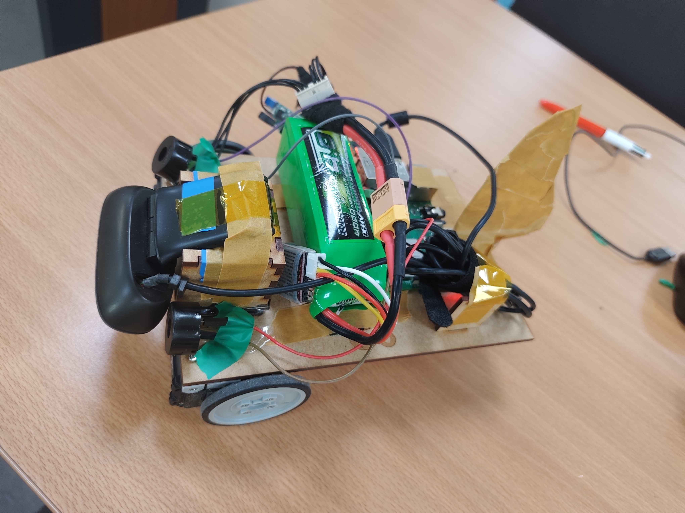
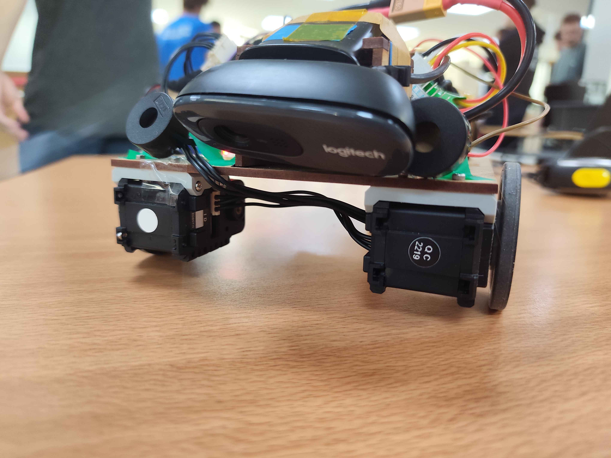

# Color Line Follower Robot (Raspberry Pi)

Autonomous robot that follows a colored line using real-time image analysis: camera acquisition, line detection, motor control and odometry.

**Team project** (6 people, one week) built around several challenges to complete. The project is finished and the robot has since been dismantled.

https://github.com/user-attachments/assets/629527d3-dfe6-4fdf-ba6f-7d0dadc875d2

   

     
     
   

## How it works

- **Vision:** each camera frame is converted to HSV and filtered by color (OpenCV) to isolate the line. The line's position in the image gives a steering value between -100 (turn left) and 100 (turn right).
- **Control:** the steering value drives the two wheels of a differential-drive robot (Dynamixel motors via `pypot`). Speed is adapted to the line color and to how sharp the turn is.
- **Course logic:** the robot follows lines of different colors in sequence (yellow, blue, red). A green marker triggers the switch to the next color, with a debounce delay to avoid false detections. At the end of the course, it stops and plays a victory melody on buzzers.
- **Odometry:** wheel speeds are read from the motors and integrated (forward and inverse kinematics) to estimate the robot's position and heading. The trajectory can be plotted in real time or saved as an image.

## Repository content

| File | Role |
|---|---|
| `direction.py` | Vision: color detection, line following, color switching |
| `moteurs.py` | Motor control (steering and speed) |
| `goto.py` | Kinematics and odometry computation |
| `odometry.py` | Live position tracking in the terminal |
| `odometry_map.py` | Real-time trajectory plot |
| `direction_map.py` | Line following with trajectory mapping |
| `defi4withcorrectreferences.py` | Challenge 4: course mapping with per-circuit orientation correction |
| `beep.py` | Buzzer sounds (color change, victory melody) |
| `stop.py` | Safely stops the motors |
| `points_parcours.json`, `trajectoire_parcours.png` | Recorded trajectory data and plot |

## Tech stack

- Python
- OpenCV, NumPy, Matplotlib
- Raspberry Pi, `gpiozero` (buzzers)
- Dynamixel motors (`pypot`)

## Hardware

- Raspberry Pi with a camera
- Differential-drive chassis with two Dynamixel wheel motors
- Two buzzers

---

HD video with sound :
https://youtu.be/4-IConR8xNQ

Note on commits: most commits were pushed from a single Git account because the code was written and tested directly on the Raspberry Pi, which was shared by the whole team. The commit history therefore does not reflect the individual contributions.

*This README was written with the help of Claude (Anthropic).*
